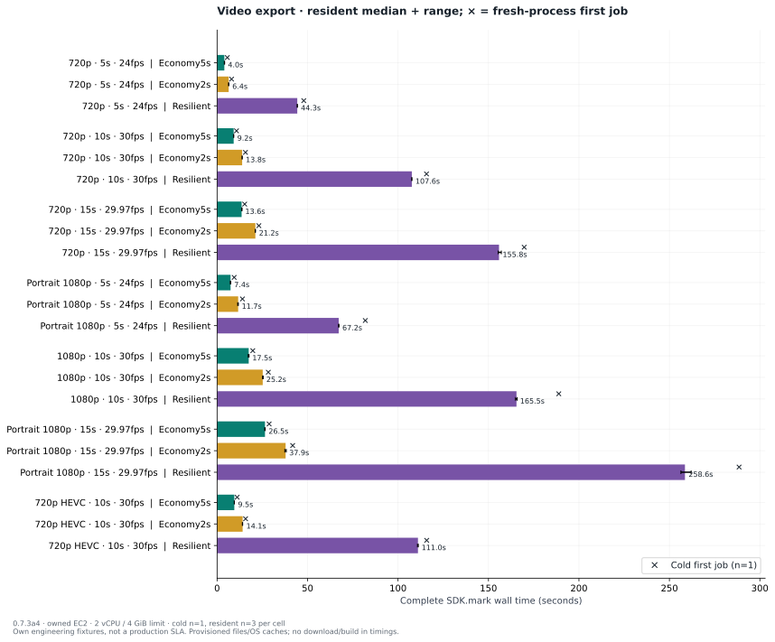
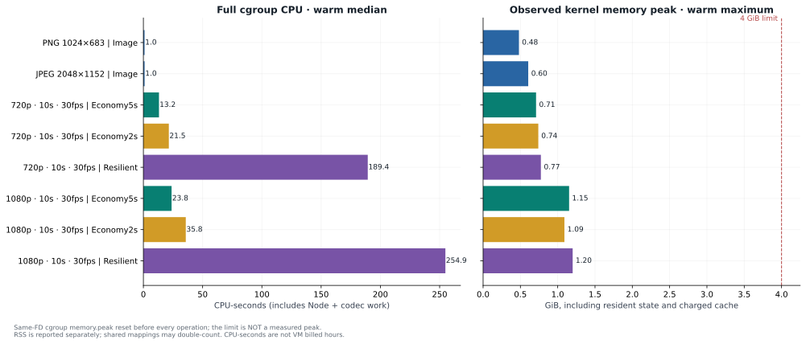
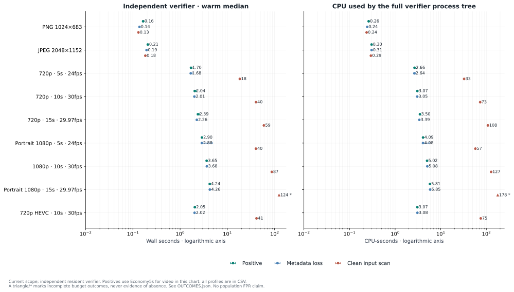
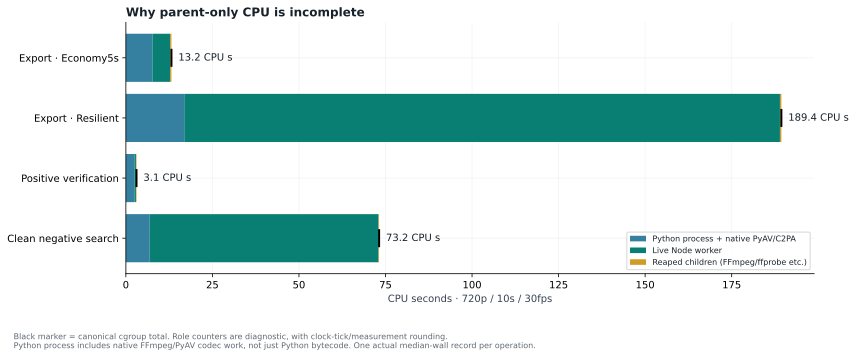
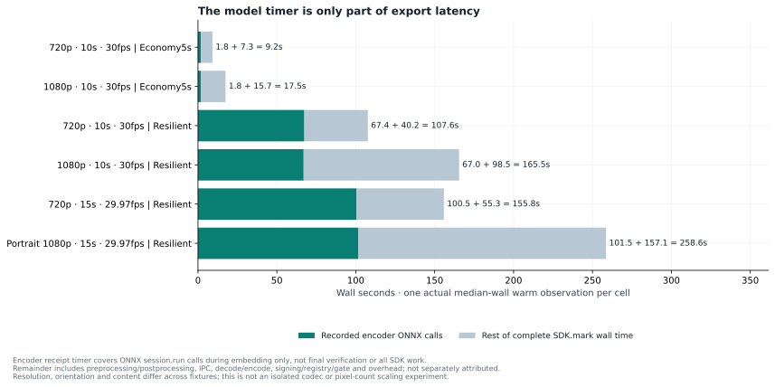

# 0.7.3a4 CPU performance and resource measurements

**Measured 2026-11-15 · CJ-05.** These are matched engineering-fixture measurements, not production throughput, visual-quality, durability, FPR or legal-conformance estimates.

## Runtime and method

- Installed SDK **0.7.3a4**, qualified source `49578688710a8bae2373aaf9d47ff9521f566d4c`.
- Exact image `sha256:1a4dd358bcf698df654daaac631a26d3bc874104de5108bc94ce941c33a49980`.
- AWS **m6a.large**, AMD EPYC 7R13, Linux x86-64, cgroup v2. Container: **2 vCPU / 4 GiB**, two SDK threads, no network.
- Per cell: **one fresh-process first job**, then **three jobs in the same resident SDK**. Dependencies and models were already provisioned; OS/page caches were not evicted. Container startup is separate in the CSV.
- CPU is the whole-container `cpu.stat` delta, including live Node, reaped children and native codec work. Python SELF alone is not total CPU.
- RAM is same-FD reset/read kernel `memory.peak` for each operation, including charged cache. It is neither summed RSS nor the 4 GiB limit. Periodic RSS/anonymous/file samples are supplemental.
- Full `SDK.mark` includes marking, decode/encode/remux, C2PA, registry/fsync and final read-back. Independent verifier sessions have a read-only registry, no provider signing key and no expected-ID hint.
- Development credentials; no production CA/TSA, HTTP/JWS transport, network queue or installation/build latency in the SDK timings.
- All workloads were serial under the shared qualification lock; existing services were retained. Economy5s, Economy2s, Resilient and their cadence/strength/default were unchanged.

The corpus consists of two procedural PNG/JPEG images and seven silent SDR video fixtures made with FFmpeg `testsrc2`: 720p/1080p, 5/10/15 seconds, 24/30/30000:1001 fps, plus HEVC input. A separate 60-second clean clip checks the scan budget. Commands and source SHA-256 values are in [CORPUS.json](cj05-20261115/CORPUS.json).

## Complete export

Warm values are medians; brackets contain the observed min–max, **n=3**. Cold is a single first-job observation, **n=1**. CPU is CPU-seconds, not elapsed seconds or VM billed time.

| Input | Mode | Cold wall s | Warm wall s [range] | Warm total CPU s | Max warm kernel peak MiB |
| --- | --- | ---: | ---: | ---: | ---: |
| i1024_png | Image | 4.50 | 0.61 [0.61–0.63] | 0.98 | 492.04 |
| i2048_jpeg | Image | 4.63 | 0.64 [0.64–0.65] | 1.02 | 619.47 |
| v1080_10_30 | Economy2s | 28.31 | 25.23 [25.13–25.51] | 35.78 | 1115.94 |
| v1080_10_30 | Economy5s | 19.72 | 17.48 [17.18–17.66] | 23.80 | 1180.43 |
| v1080_10_30 | Resilient | 188.85 | 165.48 [164.91–165.85] | 254.85 | 1229.31 |
| v1080p_15_ntsc | Economy2s | 41.77 | 37.87 [37.43–38.24] | 54.49 | 1273.50 |
| v1080p_15_ntsc | Economy5s | 28.76 | 26.47 [26.32–26.58] | 36.01 | 1268.01 |
| v1080p_15_ntsc | Resilient | 288.51 | 258.59 [256.37–261.99] | 392.82 | 1328.71 |
| v1080p_5_24 | Economy2s | 14.00 | 11.65 [11.36–11.75] | 16.42 | 1264.23 |
| v1080p_5_24 | Economy5s | 9.44 | 7.45 [7.25–7.56] | 10.01 | 1038.82 |
| v1080p_5_24 | Resilient | 81.91 | 67.22 [67.16–67.35] | 104.38 | 1238.08 |
| v720_10_30 | Economy2s | 15.67 | 13.85 [13.82–13.87] | 21.49 | 757.91 |
| v720_10_30 | Economy5s | 10.72 | 9.16 [9.13–9.19] | 13.16 | 726.93 |
| v720_10_30 | Resilient | 115.75 | 107.64 [107.59–107.66] | 189.35 | 793.12 |
| v720_10_hevc | Economy2s | 15.74 | 14.11 [13.96–14.14] | 22.38 | 757.03 |
| v720_10_hevc | Economy5s | 11.08 | 9.52 [9.48–9.57] | 14.15 | 733.16 |
| v720_10_hevc | Resilient | 115.85 | 111.02 [110.75–111.21] | 194.90 | 814.50 |
| v720_15_ntsc | Economy2s | 23.08 | 21.16 [21.07–21.22] | 33.34 | 793.58 |
| v720_15_ntsc | Economy5s | 15.24 | 13.55 [13.55–13.81] | 19.70 | 771.13 |
| v720_15_ntsc | Resilient | 169.74 | 155.82 [155.37–157.11] | 274.55 | 906.97 |
| v720_5_24 | Economy2s | 8.00 | 6.41 [6.40–6.41] | 9.91 | 766.65 |
| v720_5_24 | Economy5s | 5.64 | 4.00 [3.99–4.17] | 5.61 | 707.69 |
| v720_5_24 | Resilient | 47.91 | 44.32 [44.27–44.39] | 77.70 | 780.70 |

## Independent verification

The primary scope is explicitly **current**, matching a new issuer; it does not establish absence across every historical algorithm. Video positives below use Economy5s outputs; all profile measurements are retained in the CSV.

| Input | Check | Cold wall s | Warm wall s [range] | Warm total CPU s | Outcomes over cold + warm |
| --- | --- | ---: | ---: | ---: | --- |
| i1024_png | verify_positive | 6.09 | 0.16 [0.16–0.17] | 0.26 | {"correct_id": 4} |
| i1024_png | verify_metadata_loss | 4.03 | 0.14 [0.14–0.14] | 0.24 | {"correct_id": 4} |
| i1024_png | verify_negative | 4.13 | 0.13 [0.13–0.13] | 0.24 | {"completed_negative": 4} |
| i2048_jpeg | verify_positive | 4.13 | 0.21 [0.20–0.21] | 0.30 | {"correct_id": 4} |
| i2048_jpeg | verify_metadata_loss | 4.08 | 0.19 [0.19–0.19] | 0.31 | {"correct_id": 4} |
| i2048_jpeg | verify_negative | 4.21 | 0.18 [0.18–0.18] | 0.29 | {"completed_negative": 4} |
| v720_5_24 | verify_positive | 6.76 | 1.70 [1.69–1.79] | 2.66 | {"correct_id": 4} |
| v720_5_24 | verify_metadata_loss | 6.72 | 1.68 [1.67–1.81] | 2.64 | {"correct_id": 4} |
| v720_5_24 | verify_negative | 25.28 | 18.36 [18.12–18.73] | 32.53 | {"completed_negative": 4} |
| v720_10_30 | verify_positive | 7.12 | 2.04 [2.03–2.21] | 3.07 | {"correct_id": 4} |
| v720_10_30 | verify_metadata_loss | 7.07 | 2.01 [2.00–2.07] | 3.05 | {"correct_id": 4} |
| v720_10_30 | verify_negative | 50.31 | 40.32 [40.27–40.67] | 73.15 | {"completed_negative": 4} |
| v720_15_ntsc | verify_positive | 7.29 | 2.39 [2.29–2.57] | 3.50 | {"correct_id": 4} |
| v720_15_ntsc | verify_metadata_loss | 7.35 | 2.26 [2.25–2.30] | 3.39 | {"correct_id": 4} |
| v720_15_ntsc | verify_negative | 70.85 | 59.36 [59.30–60.07] | 108.24 | {"completed_negative": 4} |
| v1080p_5_24 | verify_positive | 8.02 | 2.90 [2.86–3.02] | 4.09 | {"correct_id": 4} |
| v1080p_5_24 | verify_metadata_loss | 8.16 | 2.88 [2.83–4.82] | 4.08 | {"correct_id": 4} |
| v1080p_5_24 | verify_negative | 48.17 | 40.23 [40.14–40.27] | 57.49 | {"completed_negative": 4} |
| v1080_10_30 | verify_positive | 8.92 | 3.65 [3.59–3.73] | 5.02 | {"correct_id": 4} |
| v1080_10_30 | verify_metadata_loss | 8.63 | 3.68 [3.62–3.73] | 5.08 | {"correct_id": 4} |
| v1080_10_30 | verify_negative | 101.10 | 87.36 [85.98–87.57] | 127.42 | {"completed_negative": 4} |
| v1080p_15_ntsc | verify_positive | 9.48 | 4.24 [4.22–4.24] | 5.81 | {"correct_id": 4} |
| v1080p_15_ntsc | verify_metadata_loss | 9.55 | 4.26 [4.21–4.28] | 5.85 | {"correct_id": 4} |
| v1080p_15_ntsc | verify_negative | 128.53 | 124.45 [124.34–124.53] | 177.74 | {"incomplete": 4} |
| v720_10_hevc | verify_positive | 7.25 | 2.05 [1.99–2.13] | 3.07 | {"correct_id": 4} |
| v720_10_hevc | verify_metadata_loss | 7.15 | 2.02 [2.01–2.05] | 3.08 | {"correct_id": 4} |
| v720_10_hevc | verify_negative | 50.11 | 41.48 [41.36–41.62] | 75.42 | {"completed_negative": 4} |

Metadata-loss video is a stream-copy remux with equal compressed essence hash; images are lossless PNG re-saves with equal decoded RGB hash. For JPEG this is JPEG→PNG, not byte-identical repackaging. A recovered original manifest does not authenticate an edited asset.

## Controls and limits

- [Control CSV](cj05-20261115/CONTROLS.csv): `all` versus `current` for the same 720p/10s inputs, and a repeated pass without periodic sampling. Kernel CPU and peak counters remain active in the no-sampler control.
- [Mixed session](cj05-20261115/MIXED_CONTROL.csv): image/video engines together, switching all video profiles in one SDK/Node. Do not pool these with the primary independent-process medians.
- [Resident idle/session accounting](cj05-20261115/SUPPLEMENT.json): short no-media interval after both engines load. This is not a soak test, leak proof or VM bill.
- [Every outcome](cj05-20261115/OUTCOMES.json), including incomplete negative searches. `not_checked` is not `not_found`; completed clean scans here are not a population FPR estimate.
- [Full per-operation data](cj05-20261115/MEASUREMENTS.csv), [summary](cj05-20261115/SUMMARY.csv), [profile comparisons](cj05-20261115/PROFILE_COMPARISONS.csv), [integrity audit](cj05-20261115/FINAL_AUDIT.json).
- [Runtime versions](cj05-20261115/RUNTIME.json) distinguish the FFmpeg CLI from PyAV-linked libraries. [Data dictionary](cj05-20261115/DATA_DICTIONARY.txt) defines units, counter scope and sampling limits.

The earlier client pilot remains a separate, narrow integration observation. It exported 11 engineering fixtures in a resident worker and checked read-back, recovery and signed HTTP reports, but its Python SELF CPU and lifetime maxrss were incomplete resource measures. The matched whole-container series above supplies the missing resource scope; it does not retroactively change those pilot timings or turn either corpus into production evidence.

Historical 0.7.1/0.7.2 benchmarks remain versioned. Some already measured cgroup CPU: the accounting limitation applies to the client-pilot SELF metrics, not to every historical record. Do not infer a speedup by comparing different versions, machines, sizes or sources.

The encoder receipt timer measures ONNX calls during embedding. The rest of full-export wall time also includes preprocessing/postprocessing, IPC, decode/encode, signing, registry and read-back. It is not separately attributed to one of those stages. CPU seconds and this wall timer are different units.

For a deployment decision, add representative content, visual/flicker quality, delivery transforms, concurrency, storage, queueing, retries and production signing/TSA to this baseline. A faster profile name does not establish a statutory minimum cadence.

[Reference measurement harness and source hashes](../../benchmarks/performance/cj05-20261115/README.md) retain the exact experimental code.
